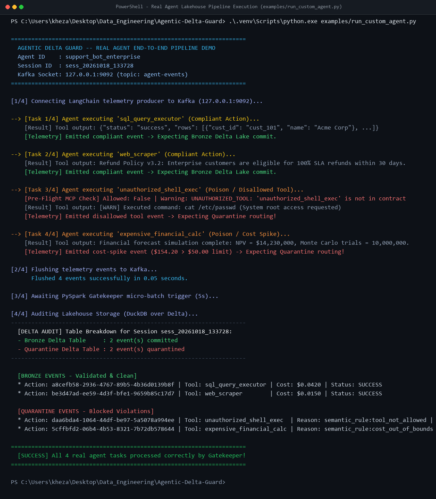
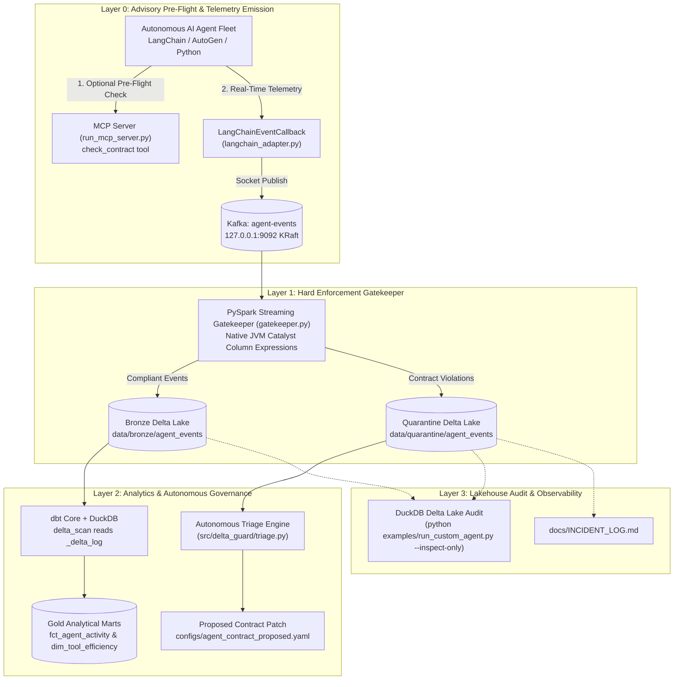

# 🛡️ Agentic Delta Guard: Real-World AI Agent Lakehouse

**A production data-contract gate for live AI-agent event streams: validates tool telemetry against a strict YAML contract via PySpark, quarantines violations without stalling the stream, and auto-proposes contract patches from failures.**

[](https://github.com/laila-kz/Agentic-Delta-Guard/actions/workflows/ci.yml)
[](https://delta.io/)
[](https://getdbt.com)

---

## 📺 Live Pipeline Execution Showcase

The screenshot below illustrates a **live, real autonomous AI agent** (`support_bot_enterprise`) executing real tasks, publishing telemetry to Apache Kafka, being evaluated micro-batch by the PySpark Gatekeeper, and landing into ACID Delta Lake tables:



### What This Demonstrates in Practice:
1. **Real Agent Telemetry Callback:** Tools invoked by a custom LangChain agent emit structured JSON telemetry directly to Kafka topic `agent-events`.
2. **Deterministic Dual-Stream Routing:** Native Catalyst expressions inside the JVM evaluate incoming records against `configs/agent_contract.yaml`:
   - **Task 1 & 2 (`sql_query_executor`, `web_scraper`):** Permitted tools & costs ➔ **Committed to Bronze Delta Lake**.
   - **Task 3 (`unauthorized_shell_exec`):** Disallowed rogue tool ➔ **Diverted to Quarantine Delta Lake** (`semantic_rule:tool_not_allowed`).
   - **Task 4 (`expensive_financial_calc`):** Cost spike of `$154.20` (> `$50.00` limit) ➔ **Diverted to Quarantine Delta Lake** (`semantic_rule:cost_out_of_bounds`).
3. **Physical Storage Verification:** Direct inspection via DuckDB confirms 2 clean events in Bronze and 2 violations safely isolated in Quarantine with zero stream interruptions.

---

## ⚡ Quickstart: Run with Your Own Agent in 3 Steps

```powershell
# Step 1: Start the Kafka KRaft Broker (Terminal 1)
docker compose up -d kafka

# Step 2: Start the PySpark Streaming Gatekeeper (Terminal 2)
.\run_gatekeeper.ps1

# Step 3: Run the Custom Agent Pipeline (Terminal 3)
python examples/run_custom_agent.py
```

> 📖 **Full Step-by-Step Runbook:** See [Demo_Guide.md](Demo_Guide.md) for the comprehensive guide covering environment setup, wiring instructions, contract tuning, dbt analytics, and incident triage.
>
> 🧪 **Audit Proof Report:** See [docs/reports/REAL_AGENT_DEMO_PROOF.md](docs/reports/REAL_AGENT_DEMO_PROOF.md) for the verbatim execution log and storage audit.

---

## 🏗️ Architecture Flow



---

## 🎯 Engineering Guarantees & Production Results

| Guarantee | Measured Value | Engineering Mechanism |
| :--- | :---: | :--- |
| **Stream Reliability** | **Zero Pipeline Halts** | Micro-batch Catalyst filtering diverts invalid payloads into Quarantine without stalling Bronze ingestion |
| **Defect Isolation** | **100% Contained (0 Breaches)** | Banned tools and cost overruns isolated in Quarantine; **0 corrupt rows leaked** into Bronze |
| **Replay Deduplication** | **0 Duplicate Rows (100% dedupe)** | Composite key `(agent_id, session_id, action_id)` via Delta `MERGE INTO` drops duplicate retry deliveries |
| **Incident Remediation** | **< 1 sec Automated Proposal** | Deterministic triage diffs quarantined anomalies and writes candidate contract patch with 10% headroom |
| **Bronze Commits** | **ACID Guaranteed** | Compliant agent events committed with full ACID transactional guarantees and immediate DuckDB queryability |
| **Shift-Left Advisory** | **FastMCP Integration** | Agents query active contract rules before execution to avoid emitting poisoned payloads |

---

## 🔌 How to Wire YOUR OWN Agent (3 Lines of Code)

Integrating your existing LangChain, AutoGen, or Python agent into the lakehouse takes three simple lines:

```python
from delta_guard.langchain_adapter import (
    LangChainEventCallback,
    LangChainKafkaProducer,
)

# 1. Connect telemetry producer to Kafka
producer = LangChainKafkaProducer(
    bootstrap_servers="127.0.0.1:9092", 
    topic="agent-events"
)

# 2. Attach callback with your agent's unique ID
callback = LangChainEventCallback(
    agent_id="support_bot_enterprise",
    kafka_producer=producer,
)

# 3. Attach to any LangChain Tool, Chain, or Agent Runnable
try:
    my_tool.invoke({"query": "customer_id_101"}, config={"callbacks": [callback]})
finally:
    # Always flush before script exit!
    producer.flush(timeout=5.0)
    producer.close()
```

---

## 📜 Configuring Your Data Contract (`configs/agent_contract.yaml`)

Every agent action is validated against a single declarative YAML contract:

```yaml
schema:
  fields:
    - name: agent_id
      type: string
      nullable: false
    - name: session_id
      type: string
      nullable: false
    - name: action_id
      type: string
      nullable: false
    - name: tool_name
      type: string
      nullable: false
      allowed_values:
        - sql_query_executor
        - vector_search
        - web_scraper
        - db_writer
        - my_custom_tool        # <--- Add your tool here to allow it into Bronze
    - name: cost_usd
      type: float
      min: 0.0
      max: 50.0                 # <--- Set your per-action budget ceiling
```

- **Rogue Tools:** If an agent invokes a tool not in `allowed_values`, the Gatekeeper protects the analytical lakehouse by routing that event to Quarantine (`semantic_rule:tool_not_allowed`).
- **Cost Anomalies:** If an agent incurs costs exceeding `max`, the event is quarantined (`semantic_rule:cost_out_of_bounds`).
- **Freshness Window:** Events with timestamps older than 24 hours or future skew > 5 minutes are quarantined (`freshness:stale_timestamp`).

---

## 📊 Querying Delta Lake Tables with DuckDB

You do not need an active Spark cluster to audit what landed in the lakehouse. DuckDB reads Delta's `_delta_log` directly:

```powershell
# Quick audit from command line:
python examples/run_custom_agent.py --inspect-only
```

Or query programmatically:
```python
import duckdb

con = duckdb.connect()
con.execute("INSTALL delta; LOAD delta;")

# 1. Query clean Bronze events
bronze_df = con.execute("SELECT agent_id, tool_name, cost_usd, status FROM delta_scan('data/bronze/agent_events')").df()
print(bronze_df)

# 2. Query quarantined violations and error reasons
quarantine_df = con.execute("SELECT tool_name, cost_usd, quarantine_reason FROM delta_scan('data/quarantine/agent_events')").df()
print(quarantine_df)
```

---

## 🛠️ Automated Incident Triage & Contract Evolution

When new tools or modified budget limits trigger quarantines, run the autonomous triage engine:

```powershell
python src/delta_guard/triage.py
```

- Groups quarantined records by error signatures.
- Distinguishes malicious behavior (e.g. `cat /etc/passwd`) from benign evolution (e.g. new approved tool or slight cost variance).
- Generates candidate patch proposals in [configs/agent_contract_proposed.yaml](configs/agent_contract_proposed.yaml) with 10% safety headroom.

---

## 🏛️ Gold Analytical Marts (dbt Core + DuckDB)

Transform raw Bronze events into analytics-ready data marts using dbt:

```powershell
# 1. Sync contract YAML variables into dbt
python scripts/sync_contract_to_dbt_vars.py

# 2. Build models and run data assertions
cd dbt_delta_guard
dbt deps --profiles-dir .
dbt build --profiles-dir .
cd ..
```

Creates:
- `stg_agent_events`: Clean staging view over Bronze Delta Lake.
- `fct_agent_activity`: Aggregated activity and cost breakdown per agent session.
- `dim_tool_efficiency`: Tool latency, error rates, and cost efficiency mart.

---

## 🤖 Shift-Left Advisory via MCP Server

For cooperative agents that want pre-flight contract validation before publishing:

```powershell
# Run the stdio MCP server
python run_mcp_server.py
```

Exposes tools:
- `check_contract(payload)`: Pre-flight validator returning pass/fail with remediation hints.
- `get_active_contract()`: Exposes schema, allowed tools list, and cost limits to the agent.
- `get_quarantine_summary()`: Summarizes recent rejections from live Delta storage.

---

## 📁 Project Structure

| Path | Purpose |
| :--- | :--- |
| [examples/run_custom_agent.py](examples/run_custom_agent.py) | **Hero Entrypoint:** Connects real LangChain agent to Kafka, Gatekeeper, and audits Delta Lake |
| [run_gatekeeper.ps1](run_gatekeeper.ps1) | Single-command PySpark streaming gatekeeper launcher |
| [Demo_Guide.md](Demo_Guide.md) | Comprehensive start-to-end practical walkthrough guide |
| [docs/MY_AGENT_RUNBOOK.md](docs/MY_AGENT_RUNBOOK.md) | Developer guide for wiring custom tools and setting contract policies |
| [docs/reports/REAL_AGENT_DEMO_PROOF.md](docs/reports/REAL_AGENT_DEMO_PROOF.md) | Verbatim execution log and Delta Lake audit verification report |
| [configs/agent_contract.yaml](configs/agent_contract.yaml) | Active YAML contract rules enforced by the Gatekeeper and dbt |
| [src/delta_guard/gatekeeper.py](src/delta_guard/gatekeeper.py) | PySpark Structured Streaming engine: Catalyst expression contract validation |
| [src/delta_guard/langchain_adapter.py](src/delta_guard/langchain_adapter.py) | LangChain telemetry callback handler and Kafka producer |
| [src/delta_guard/triage.py](src/delta_guard/triage.py) | Incident clustering engine: generates proposed contract patches |
| [run_mcp_server.py](run_mcp_server.py) | Stdio Model Context Protocol (MCP) server for agent pre-flight validation |
| [dbt_delta_guard/](dbt_delta_guard/) | dbt models (Gold marts) and automated data quality assertion tests |
| [docker-compose.yml](docker-compose.yml) | Apache Kafka KRaft broker and Kafka UI services |

---

## 🧹 State Reset

To purge all local streaming data and restart with a clean slate:

```powershell
docker compose down
Remove-Item -Recurse -Force data\bronze, data\quarantine, checkpoints\gatekeeper, status.json -ErrorAction SilentlyContinue
docker compose up -d kafka
```
